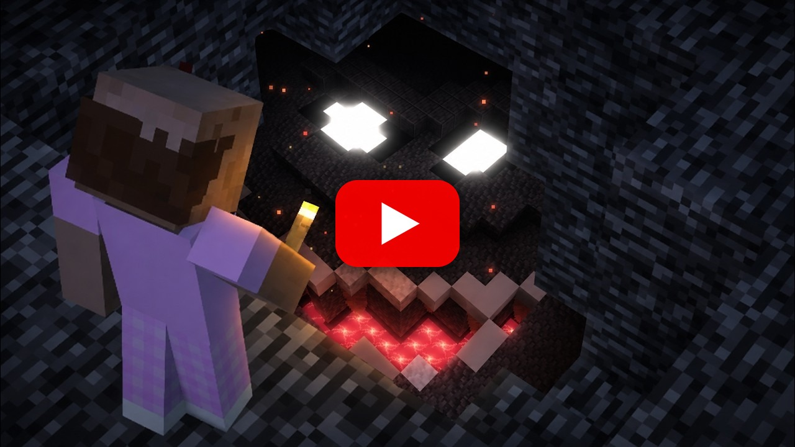

<p align="center">
  
</p>

<h1 align="center">Flashback Text</h1>

<p align="center">
  A <b>Text</b> element for the <a href="https://modrinth.com/mod/flashback">Flashback</a> replay editor: text placed in the world, animated with keyframes, and shown in your exported videos.
</p>

<p align="center">
  <a href="https://discord.gg/BXv7Mx4vny"></a>
  <a href="https://buymeacoffee.com/juler"></a>
  <a href="download/flashback-text-1.4.0.jar"></a>
</p>

<p align="center">
  
  
  
</p>

---

**Flashback Text** adds a **Text** element to the timeline of [Flashback](https://modrinth.com/mod/flashback). You can place text in the world for titles, labels, captions and cinematics. The text is part of the 3D world/scene, so it appears in the video preview and in your exported videos.

<p align="center">
  <a href="https://youtu.be/NDNXc_1OBIg"></a>
  <br>
  <b><a href="https://youtu.be/NDNXc_1OBIg">▶ Watch the showcase video</a></b>
</p>


## How it works

1. Open a replay, click **Add Element** on the timeline and pick **Text**.
2. Move the playhead to where the text should appear and press **⊕** to add a keyframe. The text is placed in front of the camera, facing it.
3. Add a second keyframe where it should disappear.
4. **Right click a keyframe** to edit the text, how it looks and much more.

## Updates

- **1.4.0 CURRENT**: New settings UI with folding sections, formatting buttons and delete/type in the header. Added the **Counter** and **3D text**. Fixed 3D text going flat from behind, 3D text not fading, and counters going past the number you set.
- **1.3.2**: Fixed the background box hiding the text when a shader pack is on.
- **1.3.1**: Fixed the camera and text jerking when they reach a keyframe. Added favorite fonts button.
- **1.3.0**: Fixed text wobbling against the camera during camera moves. Added system fonts and the Guide dropdown.
- **1.2.3**: Fixed Start Export not starting, and replay edits being lost after a restart, when a replay had text.
- **1.2.2**: Different text on the next keyframe is now untyped, then the new text typed in.
- **1.2.1**: The typewriter now types at an even speed between keyframes.

## Features

- **Text in the world** at fixed coordinates and rotation (X Y Z, yaw, pitch, roll), like a real sign
- **Several lines** and Minecraft colour/format codes (`&c` red, `&e` yellow, `&l` bold, `&o` italic, and more)
- **Colour** with transparency, **size** in blocks, left/centre/right **alignment**
- Optional **background box** (off by default) with its own colour
- **Shadow**, **readable from behind**, **show through blocks** and **world lighting** options
- **Keyframe animation**: position, rotation, size, colour and transparency blend between keyframes using Flashback's interpolation types (Smooth, Linear, Ease, Hold…). Fade text in and out by keyframing its transparency.
- **Typewriter effect** that types at an even speed between keyframes. When the next keyframe has different text, the old text is untyped and the new text typed in.
- **Counter**: put `{n}` in your text and it counts between keyframes, like 0 -> 1,000,000 or Day 1 -> Day 100. Set the number on each keyframe and pick a style (1,000 / 1000 / 1.0K / 00:42). Add a colour code in front of it like `&c{n}` to colour just the number.
- **3D text**: give your text depth in blocks so it looks like real solid letters. The sides are a darker shade of each letter's colour, or pick your own side colour. Works with readable from behind and fades like normal text.
- **New settings UI**: everything is split into folding sections (Transform, Look, Animation, Counter, 3D text) so its easy to find. Formatting buttons add the colour/format codes for you, and the keyframe's type and delete button are at the top.
- **System fonts**: use any font installed on your computer, picked per keyframe from a searchable list. Minecrafts font stays the default. Click the **☆** next to a font to favourite it and keep it at the top of the list.
- **Composition guides**: the Rule of Thirds checkbox in Visuals -> Other becomes a **Guide** dropdown with Rule of Thirds, Golden Spiral, Golden Section, Golden Triangles, Harmonious Triangles and Spiral Section, plus a **Flip** button for the ones that have a direction. Saved per replay, shown in the editor only.
- **Smooth keyframe joins**: fixes the jerk when the camera or text reaches a keyframe, so motion keeps a steady speed through each Smooth keyframe. On by default, you can turn it off in Visuals -> Other to get Flashback's original curve back.
- **Works with shaders**: tested with Iris and Solas, including the background box, 3D text and exports.

## Requirements

- Minecraft **1.21.1**
- **Flashback** for 1.21.1
- **Fabric API**
- Also runs on NeoForge through **Sinytra Connector** (with Forgified Fabric API), the same way Flashback does although some mods have compatibility issues.

## Download

Grab [`flashback-text-1.4.0.jar`](download/flashback-text-1.4.0.jar) and put it in your `mods` folder next to Flashback.

## Good to know

- **Don't remove this mod while a replay has Text tracks.** If Flashback opens that replay without Flashback Text, it can't read the replay's editor data and deletes it, camera keyframes included. Delete the Text tracks first if you want to uninstall.
- This is an **unofficial addon**. It isn't made or endorsed by Flashback's author, and it contains no Flashback code.
- **I also made this fully with AI and want to be transparent about that, it was originally meant for just me to use in a video, but I thought it was a good addon that saved a ton of time when editing so I wanted to publish it for anyone to use.**

- **Extra Yap**
This mod will be cared for, tested, and quality controlled aswell as have bugs fixed, which you can join the discord for if you find any!

## Support

- **Discord:** questions, bug reports and ideas -> [discord.gg/BXv7Mx4vny](https://discord.gg/BXv7Mx4vny)
- **Buy me a coffee:** [buymeacoffee.com/juler](https://buymeacoffee.com/juler)

## Building

```bash
./gradlew build
```

The jar is written to `build/libs/`. The first build downloads the released Flashback jar from Modrinth to compile against; it is never bundled.

## License

[MIT](LICENSE)
