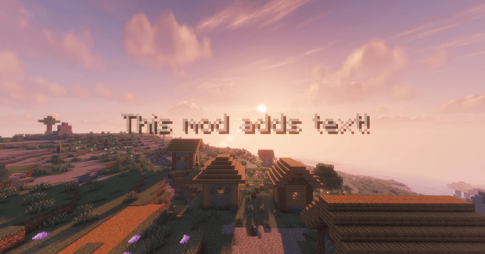

<p align="center">
  
</p>

<h1 align="center">Flashback Text</h1>

<p align="center">
  A <b>Text</b> element for the <a href="https://modrinth.com/mod/flashback">Flashback</a> replay editor: text placed in the world, animated with keyframes, and shown in your exported videos.
</p>

<p align="center">
  <a href="https://discord.gg/BXv7Mx4vny"></a>
  <a href="https://buymeacoffee.com/juler"></a>
  <a href="download/flashback-text-1.2.3.jar"></a>
</p>

<p align="center">
  
  
  
</p>

---

**Flashback Text** adds a **Text** element to the timeline of [Flashback](https://modrinth.com/mod/flashback). You can place text in the world of your replay for titles, labels, captions and signs, etc. The text is part of the 3D world/scene, so it appears in the editor preview and in your exported videos.


## How it works

1. Open a replay, click **Add Element** on the timeline and pick **Text**.
2. Move the playhead to where the text should appear and press **⊕** to add a keyframe. The text is placed in front of the camera, facing it.
3. Add a second keyframe where it should disappear.
4. **Right-click a keyframe** to edit the text and how it looks.

Text tracks work just like Flashback's own elements. Drag them with the handle to reorder, use the track menu to rename, recolour, delete or clear, toggle visibility with the eye, and undo changes. Everything is saved with the replay.

## Features

- **Text in the world** at fixed coordinates and rotation (X Y Z, yaw, pitch, roll), like a real sign
- **Several lines** and Minecraft colour/format codes (`&c` red, `&e` yellow, `&l` bold, `&o` italic, and more)
- **Colour** with transparency, **size** in blocks, left/centre/right **alignment**
- Optional **background box** (off by default) with its own colour
- **Shadow**, **readable from behind**, **show through blocks** and **world lighting** options
- **Keyframe animation**: position, rotation, size, colour and transparency blend between keyframes using Flashback's interpolation types (Smooth, Linear, Ease, Hold…). Fade text in and out by keyframing its transparency.
- **Typewriter effect** that types at an even speed between keyframes. When the next keyframe has different text, the old text is untyped and the new text typed in.

## Requirements

- Minecraft **1.21.1**
- **Flashback** for 1.21.1
- **Fabric API**
- Also runs on NeoForge through **Sinytra Connector** (with Forgified Fabric API), the same way Flashback does

## Download

Grab [`flashback-text-1.2.3.jar`](download/flashback-text-1.2.3.jar) and put it in your `mods` folder next to Flashback.

## Good to know

- **Don't remove this mod while a replay has Text tracks.** If Flashback opens that replay without Flashback Text, it can't read the replay's editor data and deletes it, camera keyframes included. Delete the Text tracks first if you want to uninstall.
- 20 ticks = 1 second.
- This is an **unofficial add-on**. It isn't made or endorsed by Flashback's author, and it contains no Flashback code.
- **I also made this fully with AI and want to be transparent about that, it was originally meant for just me to use in a video, but I thought it was a good addon and had value so I wanted to publish it for anyone to use.**

## Support

- **Discord:** questions, bug reports and ideas → [discord.gg/BXv7Mx4vny](https://discord.gg/BXv7Mx4vny)
- **Buy me a coffee:** [buymeacoffee.com/juler](https://buymeacoffee.com/juler)

## Building

```bash
./gradlew build
```

The jar is written to `build/libs/`. The first build downloads the released Flashback jar from Modrinth to compile against; it is never bundled.

## License

[MIT](LICENSE)
